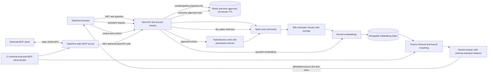

# TaskFlow AI workspace architecture

## Request and data flow

## RAG path

1. The authenticated task query returns only tasks and comments the user can currently access. Search indexes at most the 100 newest accessible tasks and 100 newest comments.
2. Each source is split into chunks up to 900 characters with 120 characters of overlap. Every chunk retains its task/comment heading and links back to its original source.
3. Gemini document embeddings are stored by source and chunk in MongoDB. Changed chunks are re-embedded; old chunks for the same source are removed.
4. The question is embedded and candidate chunks are scored with cosine similarity. The hybrid reranker combines 75% vector similarity with 25% exact lexical term coverage and keeps the best chunk per source.
5. The answer model receives up to six sources. Its structured citation IDs are filtered against the retrieved set before the API returns links, so the model cannot introduce arbitrary task IDs.

## Agent write boundary

The assistant has one read tool and two proposal tools. `create_task` and `update_task` return their arguments to the user interface but do not call `TasksService`. The API stores a signed-in user's proposal under a random approval ID in Redis for ten minutes. The confirm endpoint atomically consumes the proposal once, validates it again, and calls the normal task service, which rechecks team membership and write permission. Rejected, expired, malformed, or already-used approvals do not write.

The stdio MCP server is a separate external-client entry point. `list_tasks` uses the configured user's bearer token. `create_task` requires an explicit `confirm: true` argument before it calls the API. The MCP smoke client verifies tool discovery and the unconfirmed-write guard without creating data.

## Evaluation and observability

The CI gate uses 20 golden questions, expected source IDs, and a minimum Hit@5 of 80%. Fixed vector scores keep the reranker regression test deterministic and offline; it does not measure Gemini embedding quality. Live demo checks should record real source hits, false positives, latency, and token cost. Request logs record duration and token/cost metrics without logging task text.

## Trade-offs and next steps

- The source cap bounds cost and latency but can omit older relevant tasks. Add a configurable time window or paged retrieval if real workspaces outgrow the cap.
- The lexical reranker is cheap and explainable; it does not learn from feedback. Compare it with a cross-encoder or provider reranker using a larger judged set before adding cost.
- MCP uses a local stdio process and an access token supplied by the external client. A future hosted MCP transport should use OAuth rather than long-lived static tokens.
- The CI goldens protect deterministic retrieval code. Add a small, permission-safe live evaluation corpus when representative task data is available.
